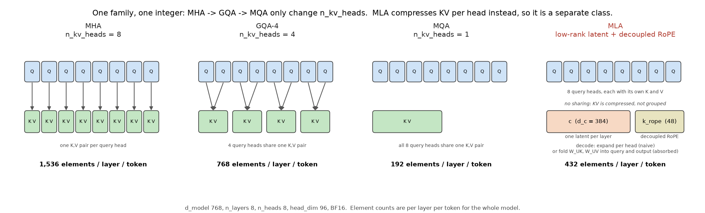
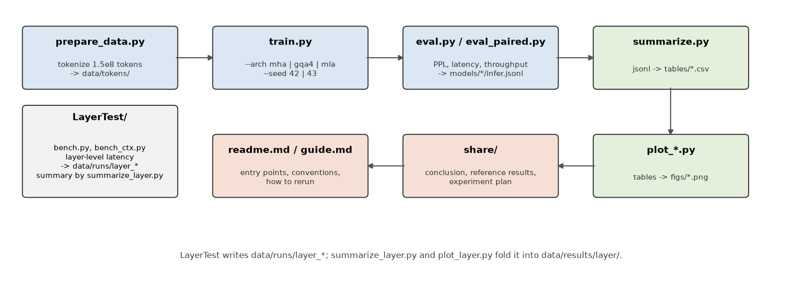

# 关于 MLA 机制效果的小体量复现探索

单卡 6 GB 显存下，用 64M 级模型与单层基准，复现 MLA（Multi-head Latent Attention）的两项机制性质：KV cache 的压缩比，以及吸收式推理相对朴素实现的时延代价。不复现 DeepSeek-V2 的训练配方，困惑度只作同预算下的质量参照。

## 项目概述

两条互不依赖的路线。

**模型级（`MLATrain/`）**：从零预训练三种注意力骨架——MHA、GQA-4、MLA，各 2 个 seed，同语料同 token 预算。记录训练墙钟与峰值显存、验证与测试困惑度、首 token 与每 token 延迟。这里的 MLA 指启用 QK-Norm 的版本；不启用 QK-Norm 的配置已作废，只保留其吸收路径的推理记录，见 `data/results/model/tables/absorbed_reference.csv`。

**层级（`LayerTest/`）**：自建 MHA、朴素 MLA、吸收 MLA 三层，参数名与形状一致，共用同一套 SDPA 与掩码逻辑。测每 token 的 KV cache 元素数、prefill 分块延迟、decode 单步延迟、峰值显存，并扫 `d_c` 与 `n_heads`，给出吸收相对朴素实现的盈亏边界。

两条路线都只测 batch = 1，因此不回答「吸收在服务端是否更划算」：吸收的收益要靠缓存密度换批量吞吐，此处未测。

### 一条轴上的三种骨架：MHA、GQA、MQA

MHA、GQA、MQA 不是三套结构，而是同一个族的三个取值，统称广义 GQA。查询头固定 8 个、每头 96 维，共享程度只由 KV 头数 `n_kv_heads` 决定：取 8 是 MHA（每头独立 KV），取 4 是 GQA-4（每 2 个查询头共享一组），取 1 是 MQA（8 个查询头共用一组）。三者只差这一个整数，投影形状与缓存量随之线性变化，`q_norm`、RoPE、SDPA、掩码完全共用。

| 骨架 | `n_kv_heads` | 每层每 token 缓存元素 | 参数量 | 本轮是否训练 |
| --- | --- | --- | --- | --- |
| MHA | 8 | 1536 | 68,630,784 | 是 |
| GQA-4 | 4 | 768 | 63,912,192 | 是 |
| MQA | 1 | 192 | 60,373,248 | 否 |
| MLA | 不适用 | 432 | 68,925,696 | 是 |

因此代码里没有独立的 MHA 与 MQA 模型文件：`MLATrain/model_gqa.py` 的 `GQAAttention` 与 `GQAModel` 就是这条轴的唯一实现。跑 MHA 用 `--arch mha`（内部把 `n_kv_heads` 设成 8），跑 MQA 在 `build_model` 里把该值设成 1 即可，不需要新增文件；`python MLATrain/train.py --help` 的 `--arch` 说明里也写了这一点。表中 MQA 的参数量按同一公式外推，不是实测。

MLA 不属于这个族。它每头保留独立查询，压缩的不是 KV 组数而是 KV 的维度：每头压成 384 维潜在向量加 48 维解耦 RoPE，每层每 token 432 元素，数量介于 GQA-4 与 MQA 之间，但机制与共享无关。代价是解码时要把 `W_UK` 与 `W_Q` 分别吸收进权重，且该吸收与 QK-Norm 冲突（见 `guide.md`）。



前三个面板是同一族的三个取值，第四个换了压缩对象：MLA 不共享 KV，而是把每头 KV 压成 384 + 48 维。图上数字即上表「每层每 token 缓存元素」一列。

## 目录

```text
MLATrain/          从零预训练、评测、数据切分
LayerTest/         注意力层基准：mha.py、naive_mla.py、absorbed_mla.py、bench.py、bench_ctx.py
scripts/model/     模型级汇总与出图
scripts/layer/     层级汇总与出图
check_sanity.py    结构与数值自检
run_all.py         一键流水线
dataset-minimind/  官方语料、tokenizer、官方权重（不入库）
data/              本项目产生的数据
  tokens/          切分后的训练/验证/测试 token（不入库）
  runs/            层级基准原始记录
  results/         汇总表与图
  logs/            运行日志
models/            训练产物，按架构分目录（不入库）
docs/              设计文档与工作日志（不入库）
share/             对外发布的方案与结论
```

## 数据与模型来源

| 资产 | 来源 | 用途 |
| --- | --- | --- |
| `pretrain_t2t_mini.jsonl`（1.24 GB，1,270,238 行，约 2.1–2.4 亿 token） | ModelScope `gongjy/minimind_dataset` | 预训练语料 |
| tokenizer（词表 6400） | ModelScope `gongjy/minimind-3` | 分词 |
| 官方权重（127.8 MB，90 个张量） | ModelScope `gongjy/minimind-3` | 结构比对与外部参考，不参与训练 |

HuggingFace 直连不可用，全部资产经 ModelScope 获取。落盘位置：语料 `dataset-minimind/corpus/`、tokenizer `dataset-minimind/tokenizer/`、官方权重 `dataset-minimind/model.safetensors`。该目录除 `readme.md` 外不入库，需本地下载。

## 快速开始

**环境**：Python 3.13 + torch 2.10.0+cu126，或按 `pyproject.toml` 用 uv 安装。

```powershell
# Windows
$env:UV_CACHE_DIR = "$PWD\.uv-cache"
$env:UV_PYTHON_INSTALL_DIR = "$PWD\.uv-cache\python"
uv sync
.\.venv\Scripts\python.exe -c "import torch; print(torch.__version__, torch.cuda.is_available())"
```

```bash
# Linux / WSL
export UV_CACHE_DIR="$PWD/.uv-cache"
export UV_PYTHON_INSTALL_DIR="$PWD/.uv-cache/python"
uv sync
.venv/bin/python -c "import torch; print(torch.__version__, torch.cuda.is_available())"
```

**五步复现**（单次训练约 2–2.7 小时，可夜间跑）：

```bash
# 1. 自检：结构与数值检查，不训练，CPU 上几十秒
python check_sanity.py

# 2. 切分 token：1.5 亿训练、100 万验证、100 万测试，写入 data/tokens/
python MLATrain/prepare_data.py

# 3. 训练三种骨架，各 2 个 seed；mla 默认带 QK-Norm
python MLATrain/train.py --arch mha  --seed 42
python MLATrain/train.py --arch gqa4 --seed 42
python MLATrain/train.py --arch mla  --seed 42

# 4. 评测：测试集 PPL 与推理指标
python MLATrain/eval.py --ckpt models/mha/mha_42_*/model.pt

# 5. 层级基准：短上下文与长上下文各一套
python LayerTest/bench.py
python LayerTest/bench_ctx.py --ctx-lens 16384 32768 --chunk 1024 --rounds 30
```

**汇总与出图**（可单独重跑，不改动原始记录）：

```bash
python scripts/model/summarize.py        # data/results/model/tables/*.csv
python scripts/model/plot_model.py       # 训练过程与结果对照 7 张
python scripts/model/plot_tradeoff.py    # 困惑度比值、解码带宽、缓存档位 3 张
python scripts/model/plot_claims.py      # 缓存与时延两条论证 2 张
python scripts/layer/summarize_layer.py  # data/results/layer/tables/layer_bench.csv
python scripts/layer/plot_layer.py       # data/results/layer/figs/*.png
python scripts/model/plot_diagrams.py    # assets/ 下两张示意图，不含测量值
```

## 数据流



模型级与层级两条路各自汇总后合流：前者写 `data/results/model/`，后者写 `data/results/layer/`。所有汇总表都只从原始 jsonl 生成，重跑脚本不覆盖原始记录。

## 一键流水线

`run_all.py` 串起检查、切分、训练、评测、层基准、汇总与出图。

```bash
python run_all.py                       # 全流程
python run_all.py --stages train,eval   # 只跑训练与评测
python run_all.py --archs mha --seeds 42
python run_all.py --dry-run             # 只打印将执行的命令
```

默认跑三组骨架 `mha`、`gqa4`、`mla`，两个 seed 共 6 个 run。`mla` 默认带 QK-Norm，产物写入 `models/mla_qknorm/`；已有 run 在 `--skip-existing`（默认开启）下跳过。

训练默认 `--batch 8 --grad-accum 2`，等效每步 8192 token，适配 6 GB 卡并默认开启梯度检查点。若仍报 `CUDA out of memory`，按顺序降 `--batch 4 --grad-accum 4`、`--seq-len 256`。

日志写入 `data/logs/run-logs/<时间戳>/`：`master.log` 记全部子进程输出，`errors.log` 记失败阶段与末 80 行，`status.json` 记各阶段起止与返回码。训练期间的监控图刷新到 `data/logs/live/live_training.png`。

## 产物

| 路径 | 内容 |
| --- | --- |
| `models/<架构>/<run_id>/model.pt` | 权重 + 结构配置 + 参数量 |
| `models/<架构>/<run_id>/last.pt` | 含优化器与随机状态，可 `--resume` 续训 |
| `models/<架构>/<run_id>/*.jsonl` | 训练、验证、推理的逐条原始记录 |
| `data/runs/layer_*`、`data/runs/layerctx_*` | 层级基准的 config 与 jsonl |
| `data/results/model/tables/*.csv` | 由 jsonl 汇总，不手写 |
| `data/results/model/paired/*.json` | 配对评测的同 seed 差值，由 `eval_paired.py` 产生 |
| `data/results/model/figs/*.png` | 模型级 12 张 |
| `data/results/layer/figs/*.png` | 层级 4 张 |

模型级图分四组。训练过程：`model_train_loss`、`model_train_ppl`、`model_train_speed`、`model_train_mem`。结果对照：`model_ppl_final`、`model_infer_compare`、`model_infer_throughput`、`model_ppl_ratio`（MLA 相对 MHA 的困惑度比值）。缓存论证：`model_claim_cache`（缓存增长与 dtype 泄漏）、`model_cache_ppl`（缓存档位与困惑度）、`model_decode_bw`（解码带宽）。时延论证：`model_claim_latency`（prefill 与 decode 的均值与 95% 置信区间；三组模型同驻显存，只用图内相对差，不与 `infer.csv` 的绝对毫秒混用）。

层级图：`layer_cache`（三层缓存足迹）、`layer_latency_ctx`（prefill 与 decode 绝对延迟）、`layer_ratio_dc`（吸收与朴素的延迟比随 `d_c`）、`layer_cache_heads`（MLA 与 GQA 的缓存随 KV 组数）。派生量如加速比不单独成图。

## 与论文的偏差

- 已实现：解耦 RoPE 的 KV 低秩压缩、吸收式推理（把 `W_UK` 吸进 `W_UV`，把 `W_Q` 吸进查询侧）、两种形态的数值等价性校验。
- 未实现：查询侧的低秩分支（`W^DQ` 后接 `W^UQ`）。本项目查询侧为满秩 `w_q`，参数量因此与论文结构存在偏差。该缺失不影响吸收路径的时延测量，吸收只作用于 KV 侧。
- 未测：batch > 1 的吞吐、超过 32K 的上下文、多卡、与官方权重的质量对齐。

## 约定

1. 结果数字只由脚本从 `data/runs/` 与 `models/*/*/*.jsonl` 汇总，不手写。
2. 两配置差值小于 seed 极差时，结论写成「未观测到显著差异」。
3. 时延对 GPU 时钟敏感。本轮锁频未生效（`nvidia-smi -lgc` 返回权限不足，实测 SM 时钟约 2310 MHz 且随负载浮动），同一检查点两次测量可差 5.8%，因此架构间时延改用 `eval_paired.py` 在同一进程内交替测量并只取配对差值；绝对毫秒数跨时段不可比。

## 文档

| 文件 | 内容 |
| --- | --- |
| `guide.md` | 环境、模型结构、训练参数、换数据、层级基准、出图、故障排查 |
| `share/experiment_plan.md` | 实验方案 |
| `share/conclusion.md` | 测试结论 |
| `share/reference_results.md` | 全部数字与推导 |
| `data/readme.md`、`models/readme.md`、`dataset-minimind/readme.md` | 三个数据目录的来源与重建方式 |
